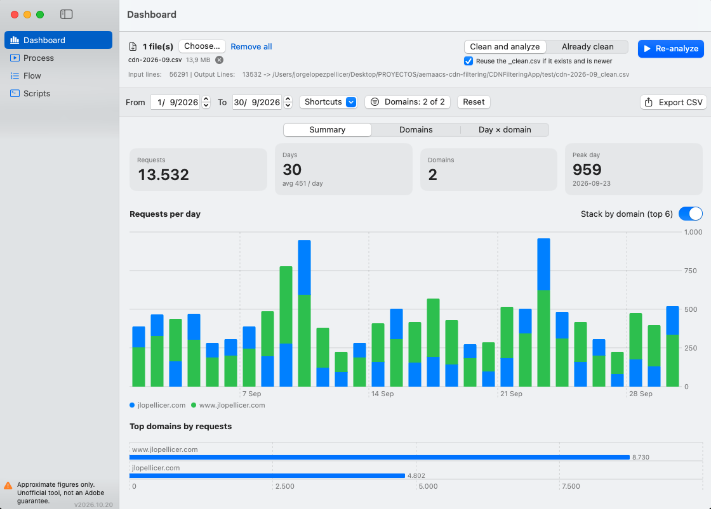
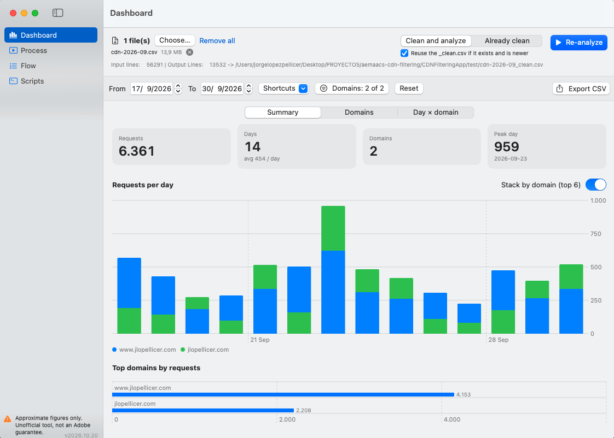
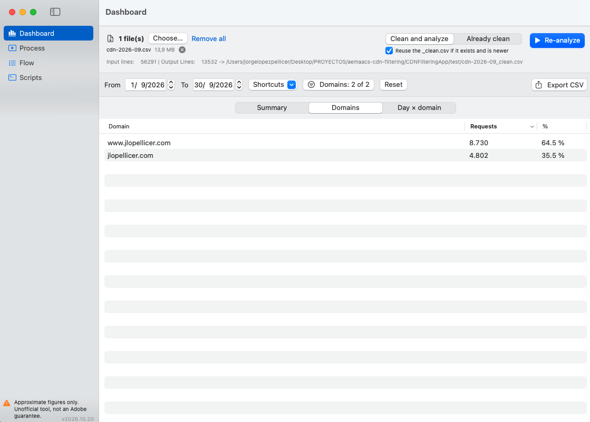
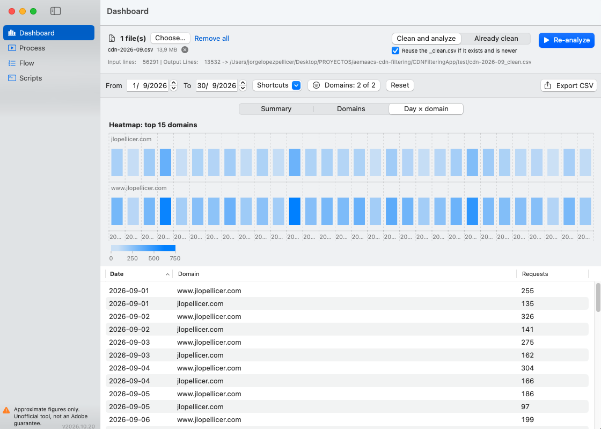

# AEM Conest


[](VERSION)
[](LICENSE)
[](#requirements)
[](Package.swift)
[](https://github.com/JorgeRZT/aem-conest/commits)
[](https://github.com/JorgeRZT/aem-conest)
[](#installing-the-unsigned-app)
[](#disclaimer)

A macOS app for reviewing **AEM as a Cloud Service** CDN logs: it filters out noise
(bots, static assets, internal paths) and counts content requests by day, domain or date
range. Drop one or more files (`.csv`, `.log`, `.txt`…) and get results without touching
the terminal. Built for files of several gigabytes.

**Current version: 2026.10.20** (see [Versioning](#versioning-and-updates)).

**[⬇ Download AEM-Conest-2026.10.20.dmg](https://github.com/JorgeRZT/aem-conest/raw/dist/dist/AEM-Conest-2026.10.20.dmg)** (macOS 14+, unsigned: see [Installing](#installing-the-unsigned-app)).

> **The app is not signed or notarized by Apple.** It is only ad-hoc signed, so macOS
> Gatekeeper will warn you the first time you open it. See [Installing](#installing-the-unsigned-app).

## Disclaimer

**AEM Conest is an independent, unofficial tool. It is not an Adobe product and is not
endorsed, supported or guaranteed by Adobe, even though its developer is an Adobe employee.**

- It is **not a 100% guarantee of anything**. It can help you approximate a real figure, but
  its results must not be considered accurate or authoritative.
- Results are request counts computed with text filters over the log files you provide. They
  are not unique visitors or sessions, and the filters may include or exclude traffic
  incorrectly (they do not remove all bots or automated traffic).
- Do not use these figures as a billing, contractual or usage-entitlement metric. For official
  numbers, use Adobe's own reporting and support channels.
- The software is provided "as is", without warranty of any kind (see the [MIT License](LICENSE)).

The same notice is available inside the app (sidebar and *About AEM Conest*).
See also [DISCLAIMER.md](DISCLAIMER.md).

## Scope and roadmap

**Current scope:** AEM Conest only calculates classic **Content Requests**, i.e. content delivery
requests (HTML pages). It does not calculate API Calls yet.

**Roadmap:**

- [ ] Calculate **API Calls** as well (e.g. `.json` and other API requests, which the current
  cleaning flow deliberately excludes because it requires `html`). The ratio between API Calls
  and Content Requests is **5 to 1** (5 API Calls correspond to 1 Content Request), so both
  metrics should be reported together and be comparable.

As with every figure produced by this tool, API Call estimates will be approximations
(see the [Disclaimer](#disclaimer)).

## Sections

- **Dashboard**: analyzes one or more files in a single pass, then lets you filter by date
  and domain instantly. Includes a per-day chart (stackable by domain), top domains, a
  day × domain heatmap, sortable tables and CSV export.
- **Process**: runs the script flow on the dropped files and shows the exact command and
  output of every step.
- **Flow**: ordered list of steps (script + arguments). Steps can be reordered, disabled,
  deleted and added. Variables: `{input}`, `{cleaned}`, `{dir}`, `{name}`, `{start}`, `{end}`.
- **Scripts**: editor for the `.sh` files. Create new scripts and add them to the flow.

Scripts and the flow are stored in `~/Library/Application Support/AEM Conest/`.

## Screenshots

Captured with the sample data in [`test/cdn-2026-09.csv`](test/cdn-2026-09.csv) (synthetic logs for
`jlopellicer.com` and `www.jlopellicer.com`, September 2026), so you can reproduce them.

**Summary**: requests per day, stacked by domain, for the whole month.



**Summary with a date range**: the same view filtered to 17-30 September.



**Domains**: requests and share per domain.



**Day × domain**: heatmap and sortable table.



## What cleaning does (`clean.sh`)

Lines matching any of the following (case-insensitive, anywhere in the line) are dropped:

- **Bots, crawlers, monitoring, proxies and AI agents**: Googlebot, Bingbot, AhrefsBot,
  SemrushBot, Applebot, ClaudeBot, ChatGPT, Perplexity, StatusCake, SiteImprove, etc.
- **Internal AEM paths**: `/etc.clientlibs/`, `/api/graphql`, `/content/experience-fragments/`.
- **Resources**: images, video, `.css`, `.js`, `.mjs`.

Only lines containing both `GET,200` and `html` (case-sensitive) are kept. The full list is in
[`default-scripts/clean.sh`](default-scripts/clean.sh). These filters do not guarantee the
removal of all automated traffic.

## Expected input format

- The date occupies characters 2 through 11 of each line in `YYYY-MM-DD` format
  (e.g. a line starting with `"2026-09-21`).
- The domain is the last comma-separated field.
- Each line is one request, with no header row. This is not a full CSV parser (no general
  quoting or multiline records).

## Requirements

- macOS 14 or later. Uses only system tools (`bash`, `grep`, `awk`, `sort`, `perl`).
- To build: Xcode / Swift 5.9+.

## Installing the unsigned app

Download [`AEM-Conest-2026.10.20.dmg`](https://github.com/JorgeRZT/aem-conest/raw/dist/dist/AEM-Conest-2026.10.20.dmg) (also published in the
[latest release](https://github.com/JorgeRZT/aem-conest/releases/latest)),
open it and drag **AEM Conest** to *Applications*. Because the app is **not signed with an Apple
Developer ID and not notarized**, macOS will refuse to open it with a double-click the first time:

- Right-click the app → **Open** → **Open**, or
- *System Settings → Privacy & Security → Open Anyway*, or
- from a terminal: `xattr -dr com.apple.quarantine "/Applications/AEM Conest.app"`

Only run builds you trust: you can always review the source here and build it yourself.

## Build

```bash
./build.sh   # produces dist/AEM Conest.app (universal) and dist/AEM-Conest-<version>.dmg
```

The resulting app is ad-hoc signed. To sign with a Developer ID and notarize, see the header
of `build.sh` (`SIGN_IDENTITY` and `NOTARY_PROFILE`).

## Versioning and updates

Versions use calendar versioning, `YYYY.MM.DD` (e.g. `2026.10.20`). The single source of truth
is the [`VERSION`](VERSION) file, which `build.sh` writes into the app's `Info.plist`.

On launch, the app asks the GitHub Releases API
(`https://api.github.com/repos/JorgeRZT/aem-conest/releases/latest`) for the latest release and,
if it is newer than the running version, shows an **Update available** dialog with a
**Download** button. You can also use *AEM Conest → Check for Updates…*. The check is a single
anonymous request to GitHub; failures (e.g. no internet) are ignored silently on launch.

To publish a new version: update `VERSION`, run `./build.sh`, commit the new `.dmg` to the `dist` branch
(and update the download links and the version badge in this README), tag the commit `v<version>` and
create a GitHub release with the `.dmg` attached.

## Layout

```
Sources/CDNFiltering/   SwiftUI code (Dashboard, Process, Flow, Scripts)
default-scripts/        original scripts; tools/gen_defaults.sh embeds them in the app
test/                   sample CDN logs (September 2026) to try the app
docs/screenshots/       images used in this README
Resources/AppIcon.svg   icon; tools/make_icon.sh generates the .icns
build.sh                builds, packages, signs and creates the .dmg
VERSION                 app version (CalVer), read by build.sh
```

## License

[MIT](LICENSE)
